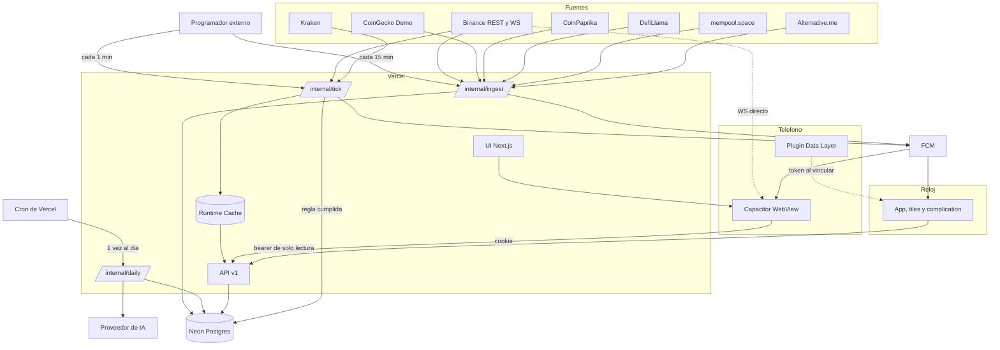

# Bloque 21: plan de producto multi-cripto (web, Android y Galaxy Watch 8)

Estado: propuesta, pendiente de tu aprobación. Fecha de verificación de límites y fuentes: 5 de noviembre de 2026.

## Lo que corrijo de tu propuesta

Revisé tu prompt contra la documentación actual y contra tu máquina. Estos puntos cambian lo que pediste:

| Pediste | Encontré | Propongo |
|---|---|---|
| Cron de Vercel para la ingesta | En Hobby solo corre una vez al día, y con hasta 59 min de holgura | Programador externo para `tick` e `ingest`; el cron de Vercel solo para el trabajo diario |
| Guardar todo en Neon con cada ciclo | Un ciclo cada 5 min o menos impide que Neon se suspenda: 0.25 CU × 730 h = 182 CU-h, y el plan gratis da 100 | Precio cada minuto sin tocar Neon; velas cada 15 min (unas 61 CU-h) |
| Fuentes sin clave | CoinGecko sin clave da unas 5 llamadas/min por IP compartida y su documentación lo descarta para consultas programadas. CoinCap v3 responde 401 sin clave y v2 ya no responde | Clave Demo gratuita de CoinGecko (100/min) solo en servidor. CoinCap queda fuera |
| Mismo prefijo de `applicationId` en teléfono y reloj | Data Layer exige el mismo package name y el mismo certificado (lo sé por la guía de Android; la página que consulté hoy no lo menciona, y se prueba en el hito 2) | `mx.bloque21.app` idéntico en ambos, compilados con el mismo keystore de depuración |
| Tipos compartidos con el reloj mediante `shared` | Zod no llega a Kotlin | DTO escritos a mano con kotlinx.serialization y fixtures JSON compartidos que validan ambos lados |
| Bearer para Android y reloj | La app Android carga la web, así que la cookie httpOnly ya funciona | Bearer solo para el reloj, con permisos mínimos |
| Puenteo de alertas del teléfono al reloj | El puenteo depende del teléfono y no permite vibración por tipo ni tus acciones rápidas | FCM directo al reloj y puenteo desactivado. Si FCM no funciona en el reloj, plan B por Data Layer |
| Argon2/bcrypt con Better Auth | Su valor por defecto es scrypt | Configurar Argon2id con `@node-rs/argon2`, como indica su documentación |
| Ollama como opción de IA | Vercel no alcanza el Ollama de tu PC | Ollama solo en desarrollo; producción necesita un proveedor de pago (pregunta 3) |

## 1. Diagnóstico del repo

**Se conserva:** App Router y Next 16, tokens de color de `globals.css` como punto de partida, `format.ts` (locale y zona horaria fija), lógica de `price-chart.tsx` (escalas, búsqueda binaria, teclado y tabla accesible), mapeos de Binance y CoinGecko de `bitcoin.ts`, Bricolage Grotesque.

**Se reescribe:**
- `bitcoin.ts`: pasa a adaptadores por fuente, sin BTC fijo.
- `use-market.ts`: de sondeo cada 20 s a WebSocket con respaldo REST.
- `session.ts`, `login/actions.ts` y `proxy.ts`: autenticación real.
- `api/bitcoin/*`: pasa a `/api/v1`.
- `dashboard-view.tsx`: se sustituye por la experiencia móvil.

**Deuda técnica encontrada:**
1. `proxy.ts` solo comprueba que exista la cookie: cualquier valor entra a `/dashboard`.
2. La contraseña demo está en el código y se muestra en `/login`.
3. `lastTicker`, `lastDetails`, `lastSentiment` y `lastCharts` viven por instancia y se asignan dentro de funciones `"use cache"`; en serverless ese respaldo no es confiable.
4. `formatUsd` usa 0 decimales: DOGE ($0.072) y ADA ($0.185) se mostrarían como $0.
5. "21 millones" y `maxSupply` asumen BTC; ETH no tiene suministro máximo.
6. Sin pruebas ni validación de respuestas externas (`as` sin comprobar).
7. `.gitignore` ignora `.env*`, así que `.env.example` no se subiría. Hay que agregar `!.env.example`.
8. La portada y el panel incumplen tus rechazos: kicker monoespaciado en mayúsculas, rejillas de tarjetas con borde y `.spinner`.
9. La animación de precio y gráfica usa `color` y `clip-path`, que repintan.
10. `README.md` conserva la línea de prueba de la rama dev.

## 2. Arquitectura



```
bloque21/
  apps/web          Next.js: UI, API, ingesta, IA
  apps/android      Capacitor y plugin Kotlin de Data Layer
  apps/wear         Kotlin + Compose for Wear OS (proyecto Gradle propio)
  packages/shared   esquemas Zod, indicadores, formato, constantes, fixtures
  scripts           envoltorios de Gradle y adb para Windows
```

Workspaces de npm, porque ya usas `package-lock.json`. Wear va en un proyecto Gradle aparte para que `cap sync` nunca lo toque.

### Decisión 1: cómo corre la UI en Android

| Criterio | (a) Capacitor con servidor remoto | (b) Export estático + API con CORS | (c) PWA/TWA |
|---|---|---|---|
| Cambios sin reinstalar | Sí, al desplegar web | No, requiere `adb install` | Sí |
| Código actual | Se reutiliza igual | Pierde server components, actions y `proxy` | Se reutiliza |
| Autenticación | Cookie, sin CORS | Bearer en el cliente y CORS | Cookie |
| Plugins nativos (Data Layer, FCM, biometría) | Sí | Sí | No: Data Layer es imposible |
| Sin conexión | Con service worker y página local | El mejor | Service worker |
| Mantenimiento en solitario | Bajo | Alto | Bajo |

**Recomiendo (a).** Con (c) no puedes vincular el reloj, y (b) te obliga a reconstruir la arquitectura y reinstalar por cada cambio.

Capacitor advierte que `server.url` "no está pensado para producción", sin explicar el motivo. Es una desviación consciente: la acepto porque instalas por adb, sin revisión de tienda, y porque el riesgo práctico que veo es depender de la red. Ese riesgo se cubre así:
- Service worker con la app shell y los últimos datos.
- `server.errorPath` con una página local cuando el primer arranque no tiene red.
- Esa página local no accede a plugins en Android, así que solo ofrece reintentar y explica qué pasó.

Cómo cambia el APK:
- Contiene solo el envoltorio nativo, los plugins, la página local y la URL.
- `CAP_ENV=dev` usa `http://localhost:3000` con `adb reverse tcp:3000 tcp:3000`.
- `CAP_ENV=prod` usa la URL de Vercel, sin cleartext.
- `npm run android:debug` no compila Next: solo sincroniza Capacitor y ejecuta Gradle. Es un cambio respecto a lo que pediste, porque la web vive en el servidor.

### Decisión 2: comunicación con el reloj

- **El reloj siempre llama directo a la API**, por Wi-Fi, LTE o el enlace del teléfono cuando Wear OS lo ofrece. Así funciona sin el teléfono cerca.
- **Data Layer solo sirve para vincular y para "abrir en el teléfono".**
- Vinculación:
  1. En Ajustes del teléfono, tocas "Vincular reloj".
  2. El plugin localiza el nodo del reloj.
  3. La web pide `POST /devices/watch` con tu sesión.
  4. El token viaja una vez por `MessageClient`.
  5. El reloj lo guarda cifrado con una clave del Android Keystore.
- **Token del reloj:** 256 bits aleatorios, guardado en Neon solo como hash SHA-256, revocable, con permisos `watch:read` y `alerts:mute`. No usa el plugin bearer de Better Auth porque su documentación lo reserva para APIs sin cookies y porque sus sesiones no permiten estos permisos reducidos.
- **Teléfono:** cookie de sesión de 30 días con renovación deslizante.

### Decisión 3: datos de mercado

Tres ritmos, para que Neon pueda dormir:

| Trabajo | Frecuencia | Disparador | Qué hace | ¿Despierta Neon? |
|---|---|---|---|---|
| `tick` | 1 min | Programador externo | Una llamada por lote a Binance (peso bajo frente a 6,000/min), guarda en Runtime Cache, compara contra umbrales de alertas en caché | Solo si se cumple una regla o falla la caché |
| `ingest` | 15 min | Programador externo | Upsert idempotente de velas, indicadores, capitalización, tipo de cambio, TVL, red y ánimo; evalúa reglas de RSI | Sí |
| `daily` | 07:00 CDMX, con holgura de 1 h | Cron de Vercel | Señales, resúmenes, resultado de señales pasadas, retención | Sí |

**Presupuesto de Neon:** con tope de 0.25 CU y suspensión a los 5 min, 4 despertares por hora dan unas 61 CU-h al mes. Quedan unas 39 CU-h, es decir, unas 156 horas de uso tuyo que además se traslapan con la ingesta. El plan gratis incluye 100 CU-h y 1 GB por proyecto. Si se agota, Launch cuesta $0.106/CU-h sin mínimo.

**Precio en pantalla:** WebSocket directo a `wss://data-stream.binance.vision`, solo con la pantalla visible y para las monedas a la vista. Sin costo de servidor. Si el WebSocket cae, sondeo a `/prices` cada 15 s. El reloj no usa WebSocket.

**Sin variables globales.** Runtime Cache es regional y no durable, así que nunca es la única copia: si está vacía, se usa el último cierre de 5 min en Neon con su hora real. El consumo de `tick` (unas 43 mil escrituras al mes) cabe en los 200 mil de Hobby.

**Fuentes verificadas hoy desde tu red:**

| Fuente | Uso | Prueba | Límite y términos | Notas |
|---|---|---|---|---|
| Binance `data-api.binance.vision` | Precio, velas, WS | 200, las 10 monedas existen | 6,000 de peso/min; 429 y luego baneo 418 si se insiste | Sin probar desde Vercel: es lo primero del hito 1 |
| CoinGecko | Capitalización, suministro, ATH, MXN/EUR, búsqueda | 200 | Demo 100/min; sin clave unas 5/min | Atribución obligatoria sin clave; en Demo confirmo el requisito al sacar la clave y la incluyo igual |
| Kraken | Validar anomalías, respaldo de precio | 200 | Sin confirmar | Revisar antes del hito 3 |
| CoinPaprika | Respaldo de CoinGecko | 200 | 20 mil llamadas/mes, uso personal, sin redistribución | Si abres la app a otros, se cambia (pregunta 1) |
| DefiLlama | TVL | 200 | Sin confirmar | Revisar antes del hito 3 |
| Alternative.me | Miedo y codicia | 200 | Atribución junto al dato | El reloj y el teléfono deben citarlo ahí mismo |
| mempool.space | Comisiones, red | **Sin respuesta en dos intentos de unos 23 s** | Sin confirmar | Puede ser tu red. Es opcional: si falla, se oculta la sección |
| CoinCap | Fuera | v3: 401; v2: sin respuesta | Requiere clave | Descartado |

**Adaptadores:** cada fuente implementa una interfaz por capacidad (`PriceSource`, `CandleSource`, `MarketSource`, etc.), valida con Zod y devuelve `{ datos, fuente, asOf }`. Un disyuntor por fuente, guardado en `source_health`, deja de llamar tras 3 fallos seguidos y respeta `Retry-After`. Esto importa porque insistir tras un 429 en Binance termina en baneo.

**Riesgo de anomalías:** si Binance se desvía más de 2% de Kraken, ese tick no dispara alertas y queda registrado.

**Monedas sin par en Binance:** usan CoinGecko para el precio, sin WebSocket y con velas solo diarias. La interfaz lo indica.

**USD:** Binance cotiza en USDT. Se trata como aproximación a USD y se aclara en la pantalla de fuentes. MXN se calcula con el tipo de cambio de CoinGecko.

### Decisión 4: alertas

- Tipos: precio, variación %, RSI extremo, señal IA.
- `tick` evalúa precio y variación con una lista compacta de umbrales en caché, y solo despierta Neon al cumplirse una. `ingest` evalúa RSI. `daily` evalúa cambios de señal.
- Si la caché se vacía, `tick` relee las reglas de Neon. Crear o editar una regla invalida la caché.
- Enfriamiento por regla (30 min por defecto) e histéresis para que un precio que oscila no vibre 20 veces.
- **Entrega:** mensaje de datos FCM de prioridad alta a cada dispositivo. El reloj crea su notificación local con canal y vibración propios. `NO_BRIDGING` evita duplicados.
- **Plan B**, si FCM no llega directo al reloj: el teléfono reenvía por Data Layer. Pierdes la entrega sin teléfono, y se decide con la prueba del hito 6.

### Decisión 5: autenticación

**Better Auth.** Auth.js ya lo mantiene el equipo de Better Auth, que lo recomienda para proyectos nuevos, y tu caso usa base de datos. Se integra con Drizzle, Argon2id configurado, límite de intentos activado y registro cerrado si la app es solo tuya.

## 3. Base de datos Neon

Conexión pooled (`DATABASE_URL`) para la web y directa (`DATABASE_URL_UNPOOLED`) solo para `drizzle-kit migrate`. Migraciones versionadas en el repo. Región `us-east-1` y funciones de Vercel en `iad1`, salvo que el hito 1 demuestre que Binance no responde ahí.

Todas las consultas de datos de usuario pasan por funciones que exigen `userId`, con una prueba que lo verifica.

| Tabla | Campos clave | Índices y notas |
|---|---|---|
| `user`, `session`, `account`, `verification` | Los de Better Auth | Generadas por su CLI |
| `user_settings` | `user_id` PK, `base_currency` (MXN), `theme`, `primary_coin_id`, `ai_model` | |
| `coins` | `id` PK (id de CoinGecko), `symbol`, `name`, `binance_symbol`, `kraken_pair`, `tint`, `has_intraday` | Índice en `symbol` |
| `user_coins` | `user_id`, `coin_id`, `position`, `added_at` | PK (`user_id`, `coin_id`) |
| `candles` | `coin_id`, `interval` (5m, 1h, 1d), `open_time`, OHLC y volumen en `double precision`, `source` | PK (`coin_id`, `interval`, `open_time`) |
| `indicators` | Misma llave + `sma20`, `sma50`, `sma200`, `rsi14`, `macd`, `macd_signal`, `macd_hist`, `volatility30` | Solo 1h y 1d |
| `coin_market` | `coin_id` PK, capitalización, volumen, suministro, `max_supply` nullable, ATH y fecha, `source`, `as_of` | Solo el último valor |
| `fx_rates` | `quote`, `as_of`, `rate` | PK (`quote`, `as_of`) |
| `source_snapshots` | `source`, `key`, `payload` jsonb validado, `as_of` | Ánimo, red, TVL |
| `source_health` | `source` PK, `last_ok_at`, `last_error_at`, `last_error`, `consecutive_failures` | |
| `portfolio_transactions` | `id`, `user_id`, `coin_id`, `side`, `quantity`, `price_usd`, `fx_mxn`, `fee_usd`, `executed_at` en `numeric` | Índice (`user_id`, `coin_id`, `executed_at`). `fx_mxn` congela el tipo de cambio de la compra: sin él, la ganancia en MXN sale mal |
| `alert_rules` | `id`, `user_id`, `coin_id`, `kind`, `direction`, `threshold`, `cooldown_min`, `muted_until`, `enabled`, `last_fired_at` | Índice parcial (`coin_id`) `WHERE enabled` |
| `alert_events` | `id`, `rule_id`, `user_id`, `fired_at`, `value`, `delivered_phone_at`, `delivered_watch_at` | Índice (`user_id`, `fired_at` desc) |
| `devices` | `id`, `user_id`, `kind`, `name`, `token_hash` único nullable, `scopes`, `fcm_token`, `last_seen_at`, `revoked_at` | Índice (`user_id`) |
| `ai_signals` | `id`, `coin_id`, `day`, `senal`, `confianza`, `score`, `razones`, `riesgos`, `invalidaria`, `horizonte`, `frase_reloj`, `datos_usados`, `input_snapshot`, `price_at_signal`, `model`, `prompt_version`, tokens | Único (`coin_id`, `day`). Global por moneda, no por usuario |
| `ai_signal_outcomes` | `signal_id`, `horizon_days`, `price_end`, `return_pct`, `hit`, `evaluated_at` | PK (`signal_id`, `horizon_days`) |
| `ai_summaries` | `scope`, `coin_id`, `user_id` nullable, `day`, `body`, `input_hash`, `model` | Único por alcance y día |
| `ai_usage` | `user_id`, `day`, `requests`, `input_tokens`, `output_tokens` | PK (`user_id`, `day`) |
| `chat_threads`, `chat_messages` | `user_id`, `thread_id`, `role`, `content`, `tool_calls`, `created_at` | Índice (`thread_id`, `created_at`) |

Las posiciones y el costo promedio se calculan desde `portfolio_transactions`, no se guardan.

**Retención y rangos de gráfica:**

| Intervalo | Se conserva | Sirve para |
|---|---|---|
| 5m | 8 días | 24 h |
| 1h | 120 días | 7 d, y 30 y 90 d agregando en la consulta a 4 h y 12 h |
| 1d | Indefinido | 1 año e indicadores largos |

Estimación: unos 150 bytes por fila dan unos 11 MB por cada 10 monedas (más o menos lo mismo en indicadores). Con 100 monedas seguirías por debajo de 1 GB. La gráfica de 24 h suma el último precio al final, ya que las velas de los últimos 15 min pueden no estar guardadas.

## 4. Contrato de API

Base `/api/v1`. Todo se valida con Zod en entrada y salida.

```jsonc
// Éxito
{ "data": {}, "meta": { "asOf": "2026-11-05T20:15:00Z", "source": "binance", "stale": false } }
// Error
{ "error": { "code": "rate_limited", "message": "Texto para mostrar", "retryAfter": 30 } }
```

Códigos: `invalid_input` 400, `unauthorized` 401, `forbidden` 403, `not_found` 404, `rate_limited` 429, `source_unavailable` 503. `stale` es verdadero si el dato tiene más de 3 min en precios y más de 45 min en velas.

| Ruta | Autenticación | Caché | Función |
|---|---|---|---|
| `GET /coins?q=` | Pública | `s-maxage=3600` | Búsqueda |
| `GET /coins/:id` | Pública | `s-maxage=900` | Métricas y fuentes |
| `GET /prices?ids=` | Pública | `s-maxage=15, swr=45` | Últimos precios |
| `GET /coins/:id/candles?range=` | Pública | `s-maxage=60, swr=300` | Velas |
| `GET /coins/:id/indicators?range=` | Pública | `s-maxage=300` | Indicadores |
| `GET /market/overview` | Pública | `s-maxage=300` | Ánimo, red, TVL |
| `/auth/*` | Better Auth | `no-store` | Sesión web |
| `GET`, `PUT /watchlist` | Cookie | `private, no-store` | Lista y orden |
| `GET`, `POST`, `PATCH`, `DELETE /portfolio/transactions` | Cookie | `private, no-store` | Movimientos |
| `GET /portfolio/summary` | Cookie | `private, no-store` | P/L en MXN y USD |
| `GET`, `POST`, `PATCH`, `DELETE /alerts` | Cookie | `private, no-store` | Reglas |
| `POST /alerts/:id/mute` | Cookie o bearer `alerts:mute` | `no-store` | Silenciar 1 h |
| `GET /signals/:coinId` | Cookie o bearer | `private, max-age=300` | Señal vigente e historial |
| `GET /digest/today` | Cookie o bearer | `private, max-age=900` | Resumen del día |
| `POST /chat` | Cookie | Streaming | Chat con herramientas |
| `GET`, `DELETE /devices`; `POST /devices/watch`; `PUT /devices/:id/fcm` | Cookie; el reloj usa bearer para su FCM | `no-store` | Vincular y revocar |
| `GET /watch/snapshot` | Bearer `watch:read` | `ETag`, `private` | Todo el reloj en una sola llamada |
| `POST /internal/tick`, `POST /internal/ingest`, `GET /internal/daily` | `CRON_SECRET` | `no-store` | Ingesta |

**Límite de tasa:** rutas públicas con caché de CDN y reglas del firewall de Vercel; intentos de acceso con Better Auth; chat e IA con `ai_usage`. No se usa Neon para limitar rutas públicas: eso lo despertaría.

## 5. Especificación funcional

**Objetivo.** Decidir con datos en el teléfono y enterarte de un vistazo en el reloj.

**Fuera de alcance:** comprar o vender desde la app, conectar exchanges o wallets, iOS, Play Store, gráficas complejas en el reloj.

### Teléfono

| Función | Flujo | Vacío | Error o sin conexión |
|---|---|---|---|
| Hoy | Abres y ves el resumen IA, tu portafolio y las monedas que más se movieron | "Agrega monedas y aquí verás cómo amanecieron" | Muestra el resumen guardado: "Escrito hoy a las 7:02" |
| Watchlist | Buscas, agregas, ordenas por arrastre, ves mini-gráficas | Sugiere las 10 iniciales | "Precios de hace 12 min. Reintentamos solos." |
| Detalle | Rango, gráfica explorable, indicadores, volumen, fuente de cada dato | Moneda sin velas: solo diaria y lo explica | Última vela con su hora; el rango sin datos se desactiva |
| Señal | Comprar, mantener o vender, confianza, 3 razones, qué la invalida, historial con resultado | "Aún no hay señal para esta moneda; se genera cada mañana" | Señal anterior con su fecha; nunca como vigente |
| Portafolio | Registras compras o ventas; costo promedio y P/L en MXN y USD | "Registra tu primera compra" | Último valor con su hora; registrar requiere conexión |
| Alertas | Crear, editar, silenciar; deslizar para borrar con opción de deshacer | Propone una alerta sobre tu moneda principal | Sin conexión queda en solo lectura |
| Chat | Preguntas; responde con herramientas que consultan Neon, sin inventar | Tres preguntas sugeridas con tus monedas reales | Conserva tu texto; al llegar al límite dice cuándo se renueva |
| Ajustes | Moneda base, tema, modelo de IA, dispositivos, fuentes y atribuciones | | Vincular reloj requiere conexión y reloj cerca |

**Permisos nativos:** los háptics, la biometría y las notificaciones se piden al usarlos por primera vez, no al abrir.

**Biometría:** opcional para abrir la app, no reemplaza la sesión.

**Criterios de aceptación clave:**
- Un dato con `stale` verdadero nunca se ve igual que uno fresco.
- Cada cifra muestra su fuente con un toque.
- Cada señal lleva el aviso breve.

### Reloj

| Superficie | Muestra | Sin datos | Sin red |
|---|---|---|---|
| Tile de precio | Moneda principal, precio grande, variación, sparkline | "Abre Bloque 21 en tu teléfono para vincular" | Último precio y "hace 40 min" |
| Tile de watchlist | 3 a 5 monedas, precio y variación | Sugiere agregarlas desde el teléfono | Igual, con la hora |
| Complication | Texto corto: `$76.1K +1.2%` | `--` | Valor y marca de antigüedad |
| Señal | Semáforo con texto, no solo color; frase de una línea | "Sin señal hoy" | Señal con fecha |
| Alerta | Moneda y valor, vibración por tipo, "Silenciar 1 h", "Abrir en el teléfono" | | Silenciar se guarda y se reintenta |
| Resumen | Tres frases, botón "Escuchar" | "Sale a las 7" | Último guardado con fecha |

**Vibración por tipo:** precio, un pulso largo. Variación, dos cortos. RSI, tres cortos. Señal, corto-largo.

**Batería y frecuencia:**
- WorkManager periódico cada 30 min con red disponible. Puedes bajarlo a 15, el mínimo del sistema.
- Una llamada a `/watch/snapshot` con `ETag` actualiza tiles y complication de una sola vez.
- Con la app abierta y activa, sondeo cada 30 s. En ambiente, sin red: atenuado, sin sparkline, solo contorno de números y un refresco de hora por minuto.
- Una alerta no espera al siguiente ciclo porque llega por FCM.

**Voz:** usa `TextToSpeech` del sistema. Si no hay voz en español instalada en el reloj, el botón no aparece.

## 6. Diseño de la IA

**Entradas, calculadas por código en `packages/shared/indicators`:** SMA 20, 50 y 200; RSI 14; MACD 12-26-9; volatilidad a 30 días; variaciones de 1, 7 y 30 días; volumen frente a su media; distancia al ATH; miedo y codicia; más antigüedad de cada dato.

**Reparto de responsabilidades:**
1. El código calcula `score` (-100 a 100) con reglas fijas y versionadas. De ahí salen la señal candidata y la confianza.
2. El modelo solo interpreta y redacta. Puede bajar una señal a `mantener` explicando por qué, pero no invertirla de comprar a vender ni cambiar la confianza. El código lo impone después de la respuesta.
3. Cada número del texto debe existir en la entrada. Si no, se reintenta una vez y luego se publica una versión de plantilla, sin modelo.
4. Si los datos están viejos, no se genera señal.

**Esquema de salida:**

```ts
const SignalOutput = z.object({
  senal: z.enum(["comprar", "mantener", "vender"]),
  razones: z.array(z.string().max(160)).length(3),
  riesgos: z.array(z.string().max(160)).min(1).max(3),
  invalidaria: z.string().max(160),
  horizonte: z.enum(["1d", "7d", "30d"]),
  frase_reloj: z.string().max(60),
  datos_usados: z.array(z.string()),
});
// El código agrega: confianza, score, input_snapshot, model, prompt_version.
```

Cambios sobre lo que pediste: `senal` sin eñe (más seguro en SQL y Kotlin), `confianza` la pone el código, y agrego `invalidaria` y `frase_reloj`, que tu especificación funcional necesita.

**Evaluación honesta:**
- El trabajo diario cierra cada señal a 1, 7 y 30 días.
- Comprar acierta si el retorno supera +1%; vender, si es inferior a -1%; mantener, si queda dentro de una banda según la volatilidad de esa moneda.
- Se compara contra dos referencias: "mantener siempre" y el `score` sin modelo. **Si el modelo no le gana a su propio `score`, conviene saberlo y decirlo en la app.**
- El porcentaje de acierto se muestra hasta tener 30 señales cerradas. Antes dice "Aún son pocas señales para medir".

**Pruebas del prompt:** casos fijos en `apps/web/src/ai/evals`: tendencia clara, mercado lateral, datos viejos, datos faltantes, y texto hostil dentro de los datos. Cambiar el prompt sube `prompt_version` y exige pasar las pruebas.

**Costos:** señales y resúmenes son globales por moneda y día, así que 1 o 1,000 usuarios cuestan lo mismo. El resumen personal se guarda por usuario y día. Volumen aproximado con 10 monedas: unos 15 mil tokens de entrada y 4 mil de salida al día, sin contar chat. Límite inicial: 30 mensajes de chat al día. Los precios exactos dependen del modelo que elijas.

**Proveedor:** AI SDK 7 con `AI_MODEL`. En desarrollo, Ollama por su API compatible con OpenAI; los modelos locales son menos confiables con salida estructurada, así que las pruebas también corren contra el modelo de producción.

**Riesgos:**
- Una señal bien redactada parece más confiable de lo que es. Por eso se muestran fecha, datos usados y acierto histórico.
- El chat conoce tu portafolio, pero no indica cuánto comprar ni vender: da contexto y datos.
- Si abres la app a terceros, "comprar/vender" personal puede tener implicaciones regulatorias que habría que revisar con un abogado.

**Aviso, junto a cada señal:** "Esto es una lectura de datos para ayudarte a decidir, no asesoría financiera. La decisión y el riesgo son tuyos."

## 7. Sistema de diseño

### Tokens de color

Contrastes calculados contra `ink`, `ink-2` e `ink-3` (AA de texto normal = 4.5).

| Token | Valor | Uso | `ink` | `ink-2` | `ink-3` |
|---|---|---|---|---|---|
| `ink` | `#14110d` | Fondo base | | | |
| `ink-2` | `#1c1813` | Zona elevada | | | |
| `ink-3` | `#26201a` | Zona activa, hoja inferior | | | |
| `cream` | `#f6f0e6` | Texto principal | 16.6 | 15.6 | 14.2 |
| `sand` | `#bdb3a2` | Texto secundario | 9.1 | 8.5 | 7.8 |
| `dust` | `#a89e8d` | Texto terciario (aclarado) | 7.1 | 6.7 | 6.1 |
| `btc` | `#f7931a` | Acción principal, con texto `ink` (8.2) | 8.2 | 7.7 | 7.0 |
| `up` | `#4fd8a5` | Sube, siempre con signo | 10.5 | 9.8 | 9.0 |
| `down` | `#ff7a6b` | Baja, siempre con signo | 7.4 | 6.9 | 6.3 |

**Tinta por moneda:** solo en la línea de su gráfica, su monograma y un velo muy tenue en su detalle. La acción principal nunca cambia de color, así la interfaz no se vuelve un arcoíris. Evité tonos cercanos a `up` y `down`.

| Moneda | Tinta | Contraste con `ink` |
|---|---|---|
| BTC | `#f7931a` | 8.2 |
| ETH | `#a9b4f5` | 9.4 |
| SOL | `#c79bf2` | 8.4 |
| BNB | `#e6c84f` | 11.4 |
| XRP | `#a8bccb` | 9.6 |
| ADA | `#7fb2ee` | 8.5 |
| DOGE | `#d8b878` | 9.9 |
| LINK | `#8ea6f7` | 8.0 |
| AVAX | `#e88fa8` | 8.0 |
| TON | `#6cc4ea` | 9.6 |

Las monedas que agregue el usuario reciben una tinta neutra derivada de su símbolo dentro de un conjunto ya validado.

**Tema claro ("Papel"):** fondo `#f6f0e6` y `#ece4d6`; texto `#1c1813`, `#5a5044`, `#6b6052`; sube `#0b6e4d`; baja `#b5301f`; acción `#994c00` (el `#a35200` que probé da 4.42 sobre el segundo fondo, por lo que no pasa AA).

### Tipografía

| Rol | Fuente | Tamaño/alto de línea |
|---|---|---|
| Precio protagonista | Bricolage Grotesque 600 | 56/56 |
| Título de pantalla | Bricolage Grotesque 600 | 28/32 |
| Sección | Bricolage Grotesque 600 | 20/26 |
| Cuerpo | IBM Plex Sans 400 | 16/24 |
| Dato secundario | IBM Plex Sans 500, cifras tabulares | 14/20 |

Quito DM Sans, por genérica, y JetBrains Mono, para cerrar la puerta a las etiquetas monoespaciadas. Compruebo las cifras tabulares de Plex en el hito 4 antes de fijarla. El reloj usa la fuente del sistema de Wear OS.

### Espacio y separación

Escala 4, 8, 12, 16, 24, 32, 48, 72. Se separa con espacio, tono y tamaño tipográfico. Las zonas elevadas no llevan borde. **Excepción permitida de línea:** retícula de gráfica y tablas de datos.

### Movimiento

| Token | Valor | Uso |
|---|---|---|
| `dur-instant` | 100 ms | Respuesta al toque |
| `dur-short` | 180 ms | Cambios de estado |
| `dur-medium` | 280 ms | Hoja inferior, cambio de pestaña |
| `dur-chart` | 600 ms | Gráfica al entrar |
| `ease-strong` | `cubic-bezier(0.23, 1, 0.32, 1)` | Entradas |
| `spring-snappy` | rigidez 500, amortiguación 40 | Botones, deslizar |
| `spring-soft` | rigidez 220, amortiguación 30 | Hojas, reordenar |

Reparto de responsabilidades, para que no compitan:
- **View Transitions:** cambio de pantalla, incluida la transición lista-detalle (`view-transition-name` por moneda).
- **Motion:** gestos, resortes, reordenar, deslizar para borrar. No uso `layoutId` entre rutas, porque se solaparía con lo anterior.

Soluciones que respetan "solo `transform` y `opacity`":
- **Rodillo de cifras:** cada dígito es una columna que se traslada con `translateY`.
- **Destello de precio:** copia del número en color encima, animando `opacity`, en lugar de transicionar `color`.
- **Gráfica que se dibuja:** cortina del color de fondo que se desplaza con `translateX`, en lugar de `clip-path`.
- **Exploración con el dedo:** una guía con `transform`; háptico `selectionChanged` solo al cambiar de punto.
- **Movimiento reducido:** sin rodillo ni cortina, cambios directos y fundidos cortos.

Medición: 60 fps en un teléfono de gama media con el perfilador de Chrome conectado por USB.

### Componentes

`Precio` (rodillo, destello, moneda), `Variacion` (signo, color), `Frescura` ("hace 3 min", fuente), `Sparkline`, `GraficaExplorable`, `FilaMoneda`, `Semaforo`, `HojaInferior`, `FilaDeslizable`, `Esqueleto` (por pantalla, con la forma real), `Aviso`, `BarraInferior`. Sin spinners: `.spinner` se elimina.

### Pantallas del teléfono

Barra inferior: **Hoy, Monedas, Portafolio, Alertas**, con Chat dentro de Hoy y detalle, y Ajustes en Hoy. Área táctil mínima de 48 dp y respeto a las safe areas.

**1. Hoy.** El resumen IA manda, como texto que se lee, no como tarjeta.
```
Jueves 5 de noviembre            [ajustes]
Bitcoin aguantó en $76,121 mientras
Solana cayó 4%. Tu portafolio bajó $312.
Escrito a las 7:02 con datos de Binance

Tu portafolio           $48,210 MXN  −0.6%

Lo que más se movió hoy
SOL   $90.18      ∿∿∿       −4.1%
LINK  $10.90      ∿∿∿       +2.3%
                     [Pregúntale al chat]
[Hoy] [Monedas] [Portafolio] [Alertas]
```

**2. Monedas.** Lista densa con ritmo, sin bordes. Mantener y arrastrar para ordenar.
```
Monedas                     [buscar]
Ordenadas por: tuyo  ▾
BTC  Bitcoin   ∿∿∿∿   $76,121   +1.2%
ETH  Ethereum  ∿∿∿∿    $2,240   −0.4%
DOGE Dogecoin  ∿∿∿∿   $0.0722   +0.8%
Precios de hace 12 s, según Binance
```

**3. Detalle.** El velo de la tinta de la moneda sube desde abajo. Explorar con el dedo cambia el precio grande.
```
‹  Solana                       [campana]
$90.18                 −4.1% en 24 h
~~~~~~~~ gráfica ~~~~~~~~~~
24H  7D  30D  90D  1A
Señal de hoy: Mantener (confianza 58)  ›
RSI 41   MACD −0.8   Volatilidad 62%
Volumen 24 h   $2.1 mil M   Binance
Capitalización $48 mil M    CoinGecko
```

**4. Señal.** Se abre como hoja inferior desde el detalle.
```
Mantener                  confianza 58 de 100
1. RSI en 41: ni sobreventa ni fuerza
2. Precio bajo su media de 50 días ($96)
3. Volumen 12% arriba de su media
Se invalida si cierra arriba de $96
Riesgo: volatilidad de 62%
Lectura de datos para ayudarte a decidir,
no asesoría financiera.
Señales previas: 14 oct Comprar +3.1% acertó
```

**5. Portafolio.** Total protagonista en tu moneda; la otra debajo. Cada fila muestra lo que ganas o pierdes, no solo el precio.

**6. Alertas.** Frases legibles ("Avísame si BTC baja de $70,000"), con interruptor. Deslizar a la izquierda borra, con "Deshacer" durante 5 s.

**7. Crear alerta.** Hoja inferior que se arma como oración. Sin formulario largo; muestra qué tan lejos está el umbral del precio actual.

**8. Chat.** Cada respuesta numérica muestra de dónde salió ("Consultado en tu portafolio, 20:14"). Respuesta en streaming con el texto apareciendo sin cursor animado llamativo.

### Pantallas del reloj (redondas)

```
Tile de precio      Tile watchlist      Señal              Alerta
    Bitcoin         BTC 76.1K +1.2%     ● Mantener         BTC bajó de
   $76,121          ETH 2,240 −0.4%     Sin fuerza clara;   $70,000
    +1.2%           SOL 90.18 −4.1%     espera volumen.    $69,870
   ∿∿∿∿∿            hace 8 min          Hoy 7:02           [Silenciar 1 h]
   hace 8 min                                              [Abrir en teléfono]
```
Compose for Wear con Material 3 y `protolayout` para tiles. Fondo negro puro para ahorrar en OLED, sólo un acento de color. Área central segura para evitar el recorte redondo. Transiciones nativas únicamente.

### Imagen

No hacen falta imágenes en estas pantallas. Monogramas tipográficos en lugar de logos de monedas, para no depender de marcas. Si quieres un ícono de app, este es el prompt:

> Ícono de app cuadrado, vista frontal ortográfica. Un solo bloque rectangular de latón cepillado, con la cifra "21" grabada en bajorrelieve, centrado y ocupando 62% del lienzo. Fondo plano color tinta cálida #14110D. Luz rasante única desde arriba a la izquierda, 30 grados, sombra corta y suave; reflejo mate naranja #F7931A solo en el canto superior del bloque. Lente de 100 mm macro con todo en foco, sin viñeta. Textura metálica fina visible a tamaño completo y limpia a 48 px. Evitar: monedas, símbolo ₿, cadenas, circuitos, neón, degradados violeta, destellos, partículas, isometría, cubos 3D y texto adicional.

## 8. Hitos

Esfuerzo en días de trabajo enfocado. Cada hito cierra con build, lint y typecheck en verde, y commits pequeños en `feat/multi-cripto`, a partir de `dev`.

| # | Hito | Días | Terminado cuando |
|---|---|---|---|
| 1 | **Recorrido mínimo:** monorepo, despliegue, Neon, `ingest` de BTC, `/prices`, Capacitor, app de reloj de una pantalla, `docs/ANDROID.md`. **Primer paso: probar Binance desde una función de Vercel** | 3–4 | Ambos APK instalados por adb en tus dispositivos muestran un precio real de Neon con su hora |
| 2 | **Identidad:** Better Auth, Argon2id, `devices`, plugin Data Layer, vinculación y revocación | 3 | Vinculas el reloj, ves `/watch/snapshot` con Bluetooth apagado y, al revocar, el reloj responde 401 |
| 3 | **Ingesta completa:** adaptadores, disyuntores, `tick`, indicadores con pruebas, retención | 4 | Apagar una fuente en pruebas degrada sin romper nada y muestra la hora real; Neon se suspende entre ciclos |
| 4 | **Diseño y núcleo móvil:** tokens, Hoy sin IA, Monedas, Detalle, gráfica, animaciones, tema. **Revisas el wireframe antes de cada pantalla** | 6–7 | 60 fps medidos en tu teléfono, AA y 48 dp comprobados, 10 monedas navegables |
| 5 | **Portafolio** | 2–3 | Casos fijos de costo promedio y P/L en MXN y USD pasan |
| 6 | **Alertas y FCM** en teléfono y **prueba de FCM en el reloj** | 4 | Alerta real llega en menos de 2 min sin duplicarse, con enfriamiento |
| 7 | **Reloj completo:** tiles, complication, ambiente, alertas con vibración y acciones | 5–6 | Lo usas un día: medición de batería anotada y funciona sin teléfono |
| 8 | **IA:** señales, resúmenes, pruebas, evaluación, voz en reloj | 5 | Las pruebas fijas pasan, todas las señales son auditables en Neon |
| 9 | **Chat** con herramientas y límites | 3 | Preguntas sobre tus datos responden con cifras exactas de Neon y el límite funciona |
| 10 | **Pulido:** sin conexión, revisión de accesibilidad, crítica de diseño, revisión de código, documentación | 3–4 | Checklist de la sección 9 completo |

**Total: unos 38 a 44 días de trabajo enfocado.** Si hay fecha límite, recorto en este orden: chat, resumen por voz, portafolio, tema claro.

## 9. Pruebas, instalación y despliegue

### Pruebas

| Tipo | Qué cubre | Herramienta |
|---|---|---|
| Unitarias | Indicadores contra valores de referencia, `score`, costo promedio, formato (DOGE no sale en $0), esquemas | Vitest |
| Adaptadores | Respuestas grabadas, respuesta malformada, 429, 418 | Vitest |
| Integración de API | Autenticación, permisos, aislamiento por `user_id`, errores, caché | Vitest + rama de Neon |
| Idempotencia | Ejecutar `ingest` dos veces no duplica; las alertas respetan enfriamiento | Vitest |
| Contrato | Los fixtures de `shared` pasan por Zod y por kotlinx.serialization | Vitest y JUnit |
| IA | Casos fijos, números inventados rechazados | Vitest |
| Interfaz | Flujos principales y accesibilidad automática | Playwright y axe |
| Físicas | Lista manual en teléfono y reloj | adb |

Lista física clave: modo avión, teléfono lejos del reloj, reloj sin carga completa, reinicio del reloj y tiles tras reinstalar.

### Entorno de tu Windows (revisado)

| Requisito | Estado |
|---|---|
| Node 24 | 24.18.0, sirve |
| JDK 21 | En `PATH` hay Temurin 21, pero `JAVA_HOME` apunta al JBR de Android Studio. Confirmo su versión en el hito 1 |
| Android SDK | Plataformas 35, 36, 37; build-tools 36: sirve. Wear OS 6 se basa en Android 16 (API 36); confirmo la versión exacta en tu reloj |
| Gradle | No hace falta instalarlo: usa el wrapper de cada proyecto |
| adb | **Tienes dos en `PATH`:** `Documentos\IDGS\platform-tools` va antes que el del SDK. Conviene dejar uno solo; versiones distintas pueden reiniciarse el servidor entre sí |
| Keystore de depuración | Existe. Si compilas en otra PC, cambia y la vinculación falla: reinstala ambos APK desde la misma máquina |
| Dispositivos | Ninguno conectado al revisar. La compilación se comprueba en el hito 1 |

Capacitor 8 pide JDK 21 y compileSdk 36 según guías secundarias; lo confirmo con el proyecto real.

### Comandos

```bash
npm run android:debug    # cap sync + assembleDebug
npm run android:install  # lo anterior + adb install -r
npm run wear:debug       # assembleDebug de apps/wear
npm run wear:install     # lo anterior + adb install -r
npm run wear:connect     # adb connect con la IP:puerto guardada en .env.local
```

Como habrá dos dispositivos conectados, los scripts usan `ADB_PHONE` y `ADB_WATCH` con `adb -s`. `versionCode` sube solo en cada compilación con un contador por fecha.

**Identidad:** `applicationId` = `mx.bloque21.app` en ambos. `versionName` empieza en `0.1.0`. El APK del reloj declara `com.google.android.wearable.standalone=true`.

### Galaxy Watch 8 por adb

1. Reloj: Ajustes > Acerca del reloj > Información de software, toca varias veces "Versión de software" hasta activar Opciones de desarrollador.
2. Conecta reloj y PC a la misma red Wi-Fi. Una red de invitados puede aislar dispositivos.
3. Opciones de desarrollador: activa "Depuración ADB" y "Depuración inalámbrica".
4. Toca "Emparejar nuevo dispositivo" y anota código, IP y puerto. En la PC, una sola vez:
   ```bash
   adb pair IP:PUERTO_DE_EMPAREJAMIENTO
   ```
5. En "Depuración inalámbrica" hay otro puerto, normalmente distinto:
   ```bash
   adb connect IP:PUERTO_DE_CONEXION
   ```

**Si pierde la conexión o cambia de IP:** vuelve a leer IP y puerto en esa pantalla, repite solo `adb connect`. No hace falta emparejar otra vez. Si sigue fallando: `adb kill-server`, `adb start-server`, y apaga y prende la depuración inalámbrica. Una reserva de IP en tu router ayuda. Apaga la depuración al terminar para ahorrar batería.

La ruta de menú en Samsung la confirmo con tu reloj y la dejo exacta en `docs/ANDROID.md`.

### Variables de entorno (`.env.example`, sin valores)

`DATABASE_URL`, `DATABASE_URL_UNPOOLED`, `BETTER_AUTH_SECRET`, `BETTER_AUTH_URL`, `CRON_SECRET`, `COINGECKO_DEMO_KEY`, `AI_MODEL`, `AI_GATEWAY_API_KEY` o la del proveedor, `AI_BASE_URL` (Ollama), `FCM_SERVICE_ACCOUNT`, `NEXT_PUBLIC_APP_URL`.

`google-services.json` y las cuentas de servicio quedan fuera del repo.

### Checklist de despliegue

**Antes**
- [ ] Build, lint, typecheck y pruebas en verde
- [ ] Migraciones probadas en una rama de Neon
- [ ] Neon: tope 0.25 CU en plan gratis, región igual a Vercel
- [ ] Variables de Vercel completas; ningún secreto con `NEXT_PUBLIC_`
- [ ] Vercel: Root Directory `apps/web`, región fijada, `CRON_SECRET`
- [ ] Programador externo: `tick` e `ingest` con encabezado secreto
- [ ] Firebase: proyecto, app Android con `mx.bloque21.app`, cuenta de servicio
- [ ] Atribuciones visibles de CoinGecko y Alternative.me

**Después**
- [ ] `tick` e `ingest` responden 200 y `source_health` está limpio
- [ ] Precio en teléfono y reloj coinciden, con hora correcta
- [ ] Alerta de prueba llega a ambos
- [ ] Consumo de CU-h en Neon revisado a las 24 h

**Reversión:** promover el despliegue anterior en Vercel. Las migraciones son aditivas, para que el código anterior siga funcionando. Revertir si los cron fallan más de 15 min, si el acceso falla o si datos viejos aparecen como frescos.

## 10. Riesgos y preguntas abiertas

| Riesgo | Efecto | Plan |
|---|---|---|
| Binance no responde desde Vercel | Sin precio principal en servidor | Primera prueba del hito 1; respaldo con Kraken y CoinGecko |
| FCM no llega directo al reloj | Alertas dependen del teléfono | Prueba en hito 6; plan B por Data Layer |
| Programador externo falla | Precios y alertas se atrasan | La app lo indica con la hora real; aviso si `tick` se atrasa |
| Se acaban CU-h de Neon | Sin datos nuevos a fin de mes | Medir a las 24 h; bajar a 30 min o pasar a Launch |
| Señal IA sin ventaja real | Falsa confianza | Comparación pública contra referencias |
| Actualización de Android WebView | Rompe la app sin que cambies nada | Pruebas físicas; poco probable pero fuera de tu control |

### Preguntas para ti

1. **¿La app será solo para ti o la usarán otras personas?** Si es solo tuya: Vercel Hobby, CoinPaprika gratis, registro cerrado. Si hay terceros o fines comerciales, Hobby y CoinPaprika gratis ya no aplican, y hay que revisar las señales con un abogado. **Recomiendo: solo tú, por ahora.**
2. **¿Usas Vercel Hobby con programador externo gratuito (cron-job.org) o pagas Pro (unos $20 USD al mes)?** Pro evita un tercero, pero no resuelve el presupuesto de Neon. **Recomiendo: Hobby con programador externo.**
3. **¿Qué proveedor de IA quieres en producción y cuánto puedes gastar al mes?** Ollama no sirve en producción. Con un presupuesto te propongo modelo y límites.
4. **¿Tu Watch 8 es LTE o Bluetooth/Wi-Fi? ¿Qué teléfono usas?** Sin LTE, "sin el teléfono" significa solo con Wi-Fi y no hay red en la calle; cambia las expectativas del hito 7. El teléfono define la meta de 60 fps.
5. **¿Hay fecha límite?** El repo se llama examen. Si hay entrega, dime cuándo y qué debe verse ese día, y recorto. Además: ¿`dev` debe seguir mostrando el sitio actual hasta entonces?

## Fuentes consultadas

- [Vercel: cron, uso y precios](https://vercel.com/docs/cron-jobs/usage-and-pricing), [plan Hobby](https://vercel.com/docs/plans/hobby), [Runtime Cache](https://vercel.com/docs/runtime-cache)
- [Neon: planes](https://neon.com/docs/introduction/plans), [límites del plan gratis](https://neon.com/faqs/free-plan-limits-and-quotas)
- [Capacitor: configuración](https://capacitorjs.com/docs/config)
- [Better Auth: bearer](https://www.better-auth.com/docs/plugins/bearer), [correo y contraseña](https://www.better-auth.com/docs/authentication/email-password), [Auth.js se integra a Better Auth](https://www.better-auth.com/blog/authjs-joins-better-auth)
- [Android: Data Layer](https://developer.android.com/training/wearables/data/data-layer), [puenteo de notificaciones](https://developer.android.com/training/wearables/notifications/bridger), [depuración por Wi-Fi](https://developer.android.com/training/wearables/get-started/debug-wifi), [novedades de Wear OS 6](https://android-developers.googleblog.com/2025/05/whats-new-in-wear-os-6.html)
- [CoinGecko: API sin clave](https://docs.coingecko.com/docs/keyless-public-api), [límites](https://docs.coingecko.com/docs/common-errors-rate-limit)
- [Binance: URLs de solo datos](https://developers.binance.com/docs/binance-spot-api-docs/faqs/market_data_only), [límites](https://developers.binance.com/docs/binance-spot-api-docs/rest-api/limits)
- [Alternative.me: índice](https://alternative.me/crypto/fear-and-greed-index/), [CoinPaprika: planes](https://docs.coinpaprika.com/api-plans.md)
